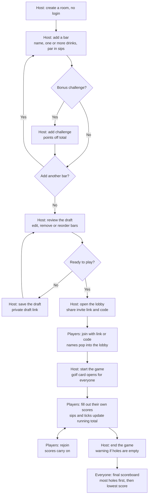

# Pub Golf Maker plan

## Status

Finished. The app is built and live at https://pubgolf-maker.web.app.

## Context

Pub Golf Maker is a web app for running a pub golf night in Stellenbosch, and could open to anyone later. A host sets up the bars, drinks, pars and bonus challenges. Players join from their phones, fill in a shared golf-style scorecard, and finish on a Kahoot-style podium.

The repo at `pubgolf_maker/` only has a `README.md`, so this is a new build. Firebase provides the database, invisible sign-in and hosting on the free Spark plan. Supabase is ruled out.

## Flow



## Game rules

- A bar is a hole. Its position in the draft sets its hole number.
- A bar can list several drinks. Each player picks one, and the app does not record which.
- Each bar has one par, counted in sips, whichever drink is chosen.
- Each challenge has a points value set by the host. Ticking it takes those points off that player's score.
- Running total = sum of (sips - par) for holes played, minus ticked challenge points. Under par is negative, over par is positive, and exactly par shows as `E`.
- Gross is total sips, Bonus is points off, Net is Gross minus Bonus, and To par is the final score.
- A player finishes by having sips entered for every hole. Otherwise they are DNF when the host ends the game.
- Everyone is ranked by most holes completed, then by lowest To par. Players level on both share a place.
- This means a finisher always beats a DNF player, however good the DNF player's score is.
- DNF players keep their label and holes played, such as `DNF -3 (3 of 5)`.
- If nobody finishes, the same ranking applies, so the leaderboard and podium still show the best of who played.

## Technical approach

- **App:** Vite, React and TypeScript as a single-page app, with `firebase` for data and `vitest` for tests. `firebase-tools` is a project dev dependency, not a global install.
- **Firebase:** Spark plan, with Firestore in `africa-south1` (Johannesburg) if offered there. The location can't be changed later.
- **Sign-in:** silent anonymous sign-in, so players only ever enter a code and a name.
- **Live updates:** Firestore listeners keep every phone on the same card.

### Data

| Path | Holds |
|---|---|
| `drafts/{secretId}` | Bars, drinks, pars, challenges, and `roomId` once the lobby opens |
| `codes/{CODE}` | The `roomId` for a room code |
| `rooms/{roomId}` | Host, status, code, locked holes, `endedAt`, `expireAt` |
| `rooms/{roomId}/hosts/{uid}` | Which devices can run the game |
| `rooms/{roomId}/players/{playerId}` | Name, device, sips per hole, ticks per hole, `expireAt` |

Status moves from `lobby` to `playing` to `ended`. A draft is unguessable and stays private until the lobby opens. Bars lock when the lobby opens, so a draft can't change once players can see it.

Room codes use four characters with look-alikes removed, such as O and 0.

### Security rules

- Single-document reads only for `drafts` and `codes`, so nobody can list them.
- Only hosts can change a room's status. The draft link lets the host reclaim the game from another device.
- New players can only be added while the room is in `lobby`.
- Players can only edit their own sips and ticks, and only while the room is `playing`. Scores lock once it's `ended`. Everyone in the room can read every score.
- Sips must be whole numbers and ticks can only be set on holes with a challenge.
- Without logins, "Is this you?" can't prove who someone is, so a player could claim another player's row by typing their name.

### Rejoining

The same link or code gets a player back in. Entering a name already on the card asks "Player1 is already in this game. Is this you?", and confirming moves that row to the new device. The phone also remembers the player, so reopening the game skips the code. There is no option to start again. In the lobby, a new player who picks a taken name is asked to choose another.

### Deleting old games

Every document gets an `expireAt`, because TTL doesn't delete nested data:

- Ended games: 15 days after the game ends.
- Unfinished games and unused drafts: 30 days after the last change.

Use a Firestore TTL policy on `expireAt`. The docs don't say whether TTL works on Spark, so check this during setup. If it doesn't, the app deletes expired games itself when someone creates a room. TTL can run up to a day late, so the app treats anything past `expireAt` as deleted and shows "This game has ended and been deleted".

## Design

The scorecard is calm and looks like a real golf card. The lobby and final scoreboard are loud, game-show moments in the same palette, with Kahoot's energy but none of its logo or colours.

| Use | Colour |
|---|---|
| Fairway green, headers and lines | `#1F5C3F` |
| Card white, background | `#FBFCF8` |
| Pale green, alternating rows | `#DDEBD8` |
| Bunker sand, bonus row | `#E4D3A1` |
| Flag red, flags | `#C8342B` |
| Pencil grey, scores | `#3A3F44` |

Fonts are Barlow Condensed for printed text and Reenie Beanie for handwritten scores.

### Scorecard

```
 STELLENBOSCH PUB GOLF                     Room code  KX47
 ┌─────────┬────┬────┬────┬──────┬─────┬─────┬──────┬────┐
 │ Hole    │  1 │  2 │  3 │ Gross│Bonus│ Net │To par│Thru│
 │ Bar     │ B  │ B  │ B  │      │     │     │      │    │
 │         │ a  │ a  │ a  │      │     │     │      │    │
 │         │ r  │ r  │ r  │      │     │     │      │    │
 │ Drinks  │Beer│Shot│Wine│      │     │     │      │    │
 │         │Cidr│    │    │      │     │     │      │    │
 │ Par     │  3 │  1 │  2 │   6  │     │     │      │    │
 │ Bonus   │ ⚑  │    │ ⚑  │      │     │     │      │    │
 ├─────────┼────┼────┼────┼──────┼─────┼─────┼──────┼────┤
 │ Player1 │(2)☑│  1 │[3]☐│   6  │ -1  │  5  │  -1  │  3 │
 │  Running│ -2 │ -2 │ -1 │      │     │     │      │    │
 ├─────────┼────┼────┼────┼──────┼─────┼─────┼──────┼────┤
 │ Player2 │ 3 ☐│ [2]│ 2 ☑│   7  │ -1  │  6  │   E  │  3 │
 │  Running│  E │ +1 │  E │      │     │     │      │    │
 └─────────┴────┴────┴────┴──────┴─────┴─────┴──────┴────┘
 Marker ____________              Attested ____________
```

- Scores look like pencil marks: a hand-drawn circle under par, a square over par.
- Tapping a cell in your own row opens a number picker. Holes with a challenge also show a tick box. Other players' rows are read-only.
- Tapping a flag shows the challenge and who has done it.
- Bar names are turned sideways. The player column stays fixed while you swipe across holes.

### Lobby

Full-screen fairway green with a huge room code, plus Share and Copy link buttons. Names pop in as chunky tags. Only the host sees Start. The invite link opens with the code filled in, so players only type a name.

### Final scoreboard

Results reveal one at a time: 3rd, 2nd, then the winner. Each podium step rises, and a flag drops onto the winner's step. Everyone else is listed below in ranked order, with a See the full card button.

## Build steps

1. **Project setup:** work only on the existing `dev` branch. Commit as each step is done and push `dev` to `origin`, with no pull requests and no changes to `main`. Save this plan and flow to `pubgolf_maker/Pub Golf Maker plan.md`. Keep `_review/` out of git.
2. **Firebase tools:** install the Firebase plugin, using the Firebase agent skills for all Firebase work:
   ```bash
   claude plugin marketplace add firebase/skills
   ```
   ```bash
   claude plugin install firebase@firebase
   ```
   Then add the app and `firebase-tools` to the project.
3. **Firebase project (your part):** run `npx firebase login` and create the project, because these need your Google account. I then connect Firestore, anonymous sign-in, Hosting and the TTL policy, and check TTL works on Spark.
4. **Scoring:** write and test the rules above in `src/lib/scoring.ts`, including running totals, `E`, Thru, DNF, ranking by holes then score, ties and no finishers.
5. **Host draft:** room creation, bars, drinks, par, challenges, drag and arrow reordering, autosave and the private draft link.
6. **Lobby and joining:** code and invite link, name entry, live names and Start. Set up `firestore.rules`.
7. **Scorecard:** the card, number picker, tick boxes, running totals and live updates.
8. **Rejoining and ending:** the "Is this you?" check, device memory, the empty-holes warning and locked scores.
9. **Final scoreboard:** the podium reveal, ranked list and full card view.
10. **Deleting old games:** `expireAt`, the TTL or app cleanup, and the deleted-game message.
11. **Deploy:** run `npx firebase deploy` for Hosting and the rules, then test on real phones.

## Main files

- `src/lib/scoring.ts` holds the game rules and `src/lib/scoring.test.ts` tests them.
- `src/lib/firebase.ts` handles setup and sign-in, and `src/lib/game.ts` handles reads and writes.
- `src/pages/` holds the Home, Draft, Join, Lobby, Card and Scoreboard screens.
- `firestore.rules`, `firebase.json` and `.firebaserc` hold the Firebase configuration.

## Verification

- `npm test` covers scoring, including the card example above: Player1 ends on `-1` and Player2 on `E`.
- Firebase Emulator tests check the security rules, such as blocked late joins, locked scores, no editing other players' scores and no listing of drafts. These need Java, so I'll give you the install command if it's missing.
- Two browser sessions on the emulator play a full game: draft, save and reopen by link, join, score, rejoin, DNF and podium.
- After each screen is built (steps 5 to 9), Playwright opens the running app so I can use it like a player, check screenshots at phone width and fix layout or behaviour problems before moving on.
- Playwright also runs the full game across separate browser sessions, so the lobby, live scores, rejoining and podium are tested the way real phones would use them.
- Final screenshots are saved to `_review/` for your review once the build is done.
- After deploying, a real game on two or more phones confirms live updates and the invite link. Firebase's usage page confirms it stays within the free limits.

## Open checks

- Firestore's Johannesburg location on Spark isn't confirmed by the docs. If it isn't offered, use the closest available.
- Firebase's docs don't say what happens at a free limit. I expect the app to stop until the limit resets, not to charge you, because Spark has no payment method.
- `origin` still uses HTTPS, so pushing to `dev` needs a GitHub login. Your account has write access to the repo.
